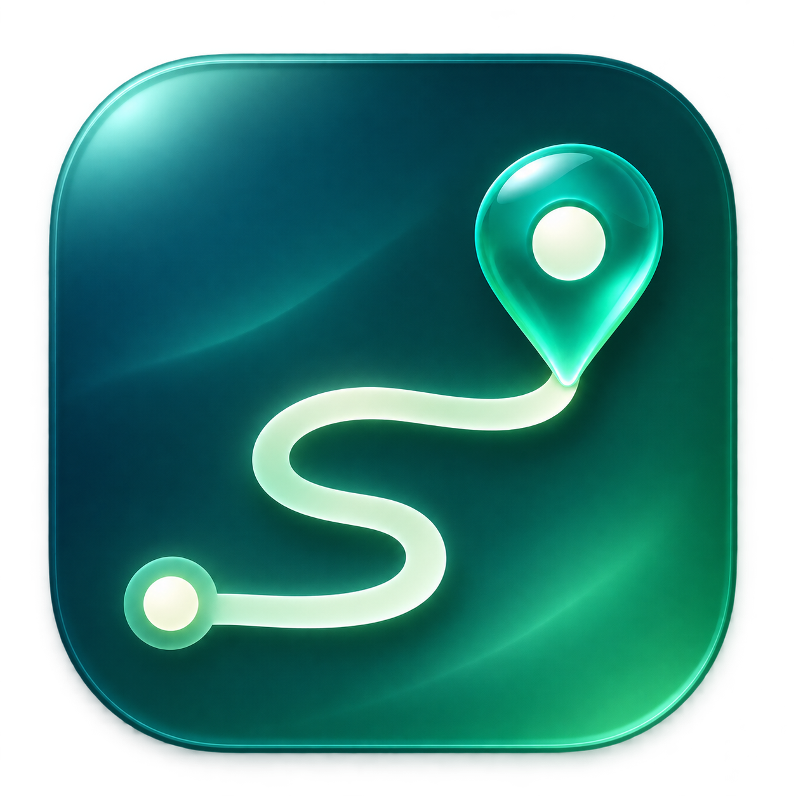

# Route Studio Dual · 双设备版



同时连接两台 USB iPhone，分别编辑路线、配速并回放定位。两个通道有各自的连接、进度、暂停与恢复状态，也提供一起连接、一起开始和全部结束。

本版本从 Route Studio v1.1.0 单设备版扩展。原单设备 App、桌面入口和安装包继续保留；公开的 [v1.1.0 下载](https://github.com/cheng01023-ops/route-studio/releases/tag/v1.1.0) 也保持不变。

## 使用

完整解压 `RouteStudio-Dual-Mac.zip`，双击 **双设备定位工具.app**，保持它与 `Route Studio Dual.app` 在同一文件夹。

1. 退出单设备版，再用两根支持数据传输的数据线连接手机，解锁并信任 Mac。
2. 在顶部为通道 A、B 分配不同的 iPhone，连接两台，等待各自显示就绪。
3. 点击通道卡片切换地图和编辑器，为每台设置路线与配速。切换查看不会停止另一台。
4. 分别开始，或在两端都就绪后一起开始。打开 App、连接手机和载入路线都不会自动开始定位回放。
5. 按需暂停、继续，或全部结束并恢复定位。退出时分别处理两台的恢复结果。

[详细使用指南](docs/USAGE.zh-CN.md) · [验证范围](docs/VALIDATION.md)

## 功能

- 两个独立设备通道，独立路线、配速、距离、运行进度和草稿。
- 通道独立开始、暂停、继续、结束与固定位置。
- 双通道批量连接、开始、暂停/继续及结束恢复。
- 将当前路线复制到另一空闲通道，适合同一路线双机使用。
- 地图选点、拖动编辑、搜索、GPX/JSON 导入导出、闭合多圈。
- 国内高德底图 GCJ-02 与设备 WGS84 双向转换，路线文件始终使用 WGS84。
- 同设备占用保护、实际连接目标核对，以及开发镜像缓存准备互斥。
- 独立的 App 名称、Bundle ID 和偏好域，与单设备版分别安装。

## 要求

Apple Silicon Mac、macOS 15+。两台 iPhone 都需信任 Mac 并开启开发者模式；当前连接代码面向 iOS 17+。安装包包含 Python 运行组件，首次准备开发镜像可能需要联网。预编译 App 为本地签名，未经过 Apple 公证。

两个版本可以同时安装。使用定位时请只运行其中一个版本，避免同一台手机收到多个工具的控制。

## 构建

在本双设备版源码目录中，需要 Python 3.14 和 Xcode / Command Line Tools：

```sh
python3 build.py
python3 package_release.py
```

产物位于 `dist/`：

```text
Route Studio Dual.app
双设备定位工具.app
双设备定位工具.command
RouteStudio-Dual-Mac.zip
RouteStudio-Dual-source.zip
```

可用 `ROUTE_STUDIO_PYTHON` 指定已有虚拟环境，`ROUTE_STUDIO_BUILD` / `ROUTE_STUDIO_OUTPUT` 覆盖构建与输出目录。签名使用系统临时目录中的短暂副本，以避开同步目录自动附加的 Finder 元数据，完成后清理。

## 实现

SwiftUI / MapKit 界面使用两个 `StudioModel` 和两个独立 Python Bridge 子进程。pymobiledevice3 的 userspace tunnel 每进程只支持一个实例，因此每台设备单独使用一个进程和私有 stdin/stdout JSON 通道。不同通道之间没有共享的回放时钟或路线状态。

每设备的跨进程文件锁防止重复占用；首次开发镜像准备另用短期锁串行化，定位回放保持并行。连接目标由 USB serial 指定并与开发服务返回的身份核对。程序不监听网络控制端口。

`Sources/` 为界面与双通道协调；`backend/` 为定位桥接、设备租约与回放引擎；`tests/` 包含会话隔离、批量失败处理、恢复流程和打包测试；`Resources/` 与 `examples/` 保留默认路线及图标。

## 许可

项目源码采用 **GPL-3.0-or-later**，见 [LICENSE](LICENSE)。第三方许可与对应源码见 [THIRD_PARTY_NOTICES](THIRD_PARTY_NOTICES.txt)、[许可全文](Licenses/) 及 [源码来源](docs/THIRD_PARTY_SOURCES.md)。

本工具使用设备开发定位服务，适用于自有或获授权设备的位置服务开发与测试。项目与 Apple、微信或其他第三方服务无隶属关系。
